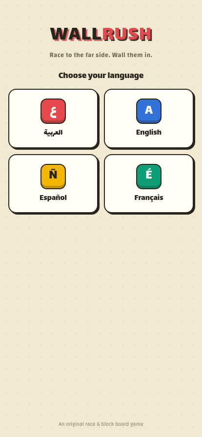
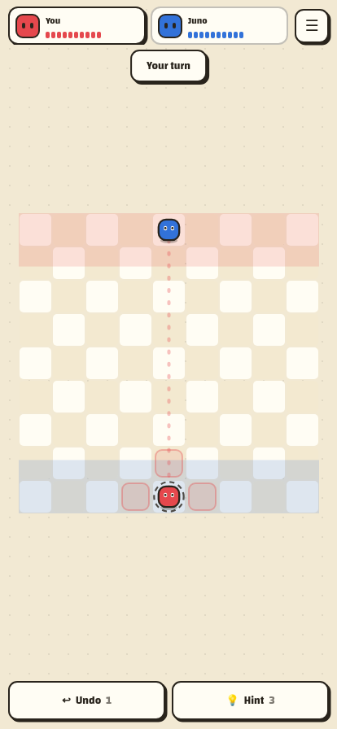

# 🧱 WALLRUSH — سباق الجدران

**والرَش** — لعبة لوحية استراتيجية كاملة للموبايل، مستوحاة من فكرة ألعاب **السباق والجدران** (مثل Blocade / Quoridor): اسبق خصمك إلى الجهة المقابلة، واعترض طريقه بالجدران!

## ✨ المميزات

- 🏁 **الفكرة الأساسية**: لوح 9×9 — في كل دور تتحرك خطوة واحدة **أو** تضع جداراً. أول من يصل الجهة المقابلة يفوز.
- 🧱 **10 جدران** لكل لاعب في المبارزة الكلاسيكية — الجدران تعيق الجميع.
- 🦘 **القفز**: اقفز فوق الخصم المجاور، وإذا اعترضه جدار خلفه فاقفز قطرياً.
- 🚫 **قاعدة منع الحصار**: لا يمكن أبداً سدّ كل الطرق — يجب أن يبقى طريق للهدف (مطبّقة بالكامل).
- 🤖 **ذكاء اصطناعي** بثلاثة مستويات (سهل/متوسط/صعب) بخوارزمية Minimax مع تشذيب Alpha-Beta.
- ⚡ **وضع Blitz**: 6 جدران و10 ثوانٍ لكل دور — حركة تلقائية عند انتهاء الوقت.
- 🎯 **وضع الرباعية**: حتى 4 لاعبين (بشر/روبوتات) على نفس الشاشة، كل واحد من جهة.
- 🌍 **4 لغات**: العربية (RTL كامل) • English • Español • Français — شاشة اختيار اللغة عند أول تشغيل.
- 🎨 **تصميم «نادي الألعاب الورقية»**: خلفية كريمية دافئة، ألوان مسطحة جسورة (أحمر/أزرق/ذهبي/أخضر)، حدود حبرية سميكة وظلال صلبة — بدون تدرّجات. خطوط **Lalezar** و**Changa** مدمجة داخل الملف (تعمل دون اتصال).
- 💡 **تلميحات** و**تراجع** و**دليل المسار** لمساعدة المبتدئين.
- 📊 إحصائيات محفوظة (انتصارات، مباريات، سلسلة).
- 🔊 مؤثرات صوتية مولّدة برمجياً (بدون ملفات خارجية).
- 📱 **ملف واحد** يعمل دون اتصال — لا حسابات، لا سيرفرات.

## 🎮 طريقة اللعب

| | |
|---|---|
| 👆 **التحرك** | اضغط على خلية متوهجة بجانب قطعتك |
| 🧱 **وضع جدار** | اضغط على الفجوة بين الخلايا → تظهر معاينة → أكّد بزر ✓ (أو اضغط الجدار مرة أخرى) |
| ⟳ **تدوير الجدار** | زر التدوير قبل التأكيد |
| ⌨️ **لوحة المفاتيح** | الأسهم/WASD للحركة، Enter للتأكيد، Esc للإلغاء |

## 🚀 التشغيل

افتح `index.html` في أي متصفح — هذا كل شيء. أو فعّل **GitHub Pages** من إعدادات المستودع لتلعب عبر الرابط.

---

# 🧱 WALLRUSH (English)

A complete mobile-first strategy board game inspired by **race & block** games (Blocade / Quoridor): race to the far side before your rival walls you in!

## ✨ Features

- 🏁 **Core idea**: 9×9 board — each turn, move one step **or** place a wall. First to reach the opposite side wins.
- 🧱 **10 walls** each in classic duel — walls block everyone.
- 🦘 **Jumps**: hop over an adjacent rival; if blocked behind, jump diagonally.
- 🚫 **No-full-block rule**: a path to the goal must always remain (fully enforced).
- 🤖 **AI** with 3 difficulties (Easy/Medium/Hard) — Minimax with Alpha-Beta pruning.
- ⚡ **Blitz mode**: 6 walls, 10 seconds per turn, auto-move on timeout.
- 🎯 **Squad mode**: up to 4 players (human/bot mix) on one screen, one per edge.
- 🌍 **4 languages**: العربية (full RTL) • English • Español • Français — language picker on first launch.
- 💡 Hints, undo, and a path guide for beginners.
- 📊 Local stats (wins, games, streak).
- 🔊 Procedural sound effects (no external files).
- 📱 **Single file**, works offline — no accounts, no servers.

## 📸 Screenshots

| Language picker | Mid-game |
|---|---|
|  |  |

## 🚀 Run it

Open `index.html` in any browser — that's it. Or enable **GitHub Pages** in the repo settings to play from a URL.

## 🛠 Tech

Pure vanilla HTML/CSS/JS in a single file (~90 KB). Canvas rendering, WebAudio synth SFX, localStorage persistence. No dependencies, no build step, no tracking.

---
*An original implementation of public race-and-block board game rules — not affiliated with Blocade or Quoridor.*
