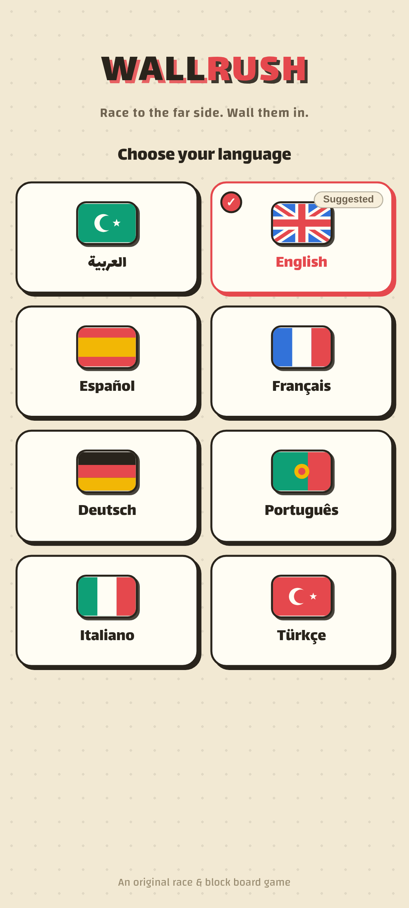
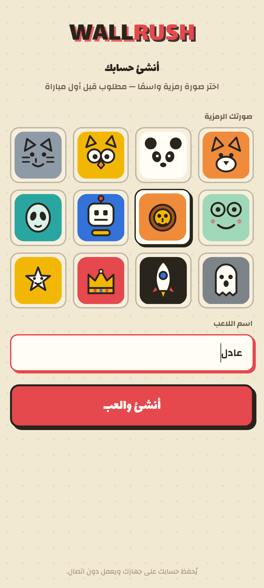
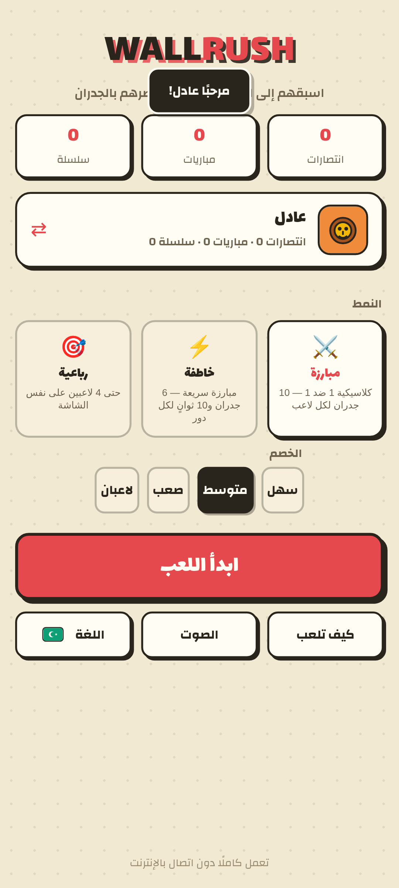
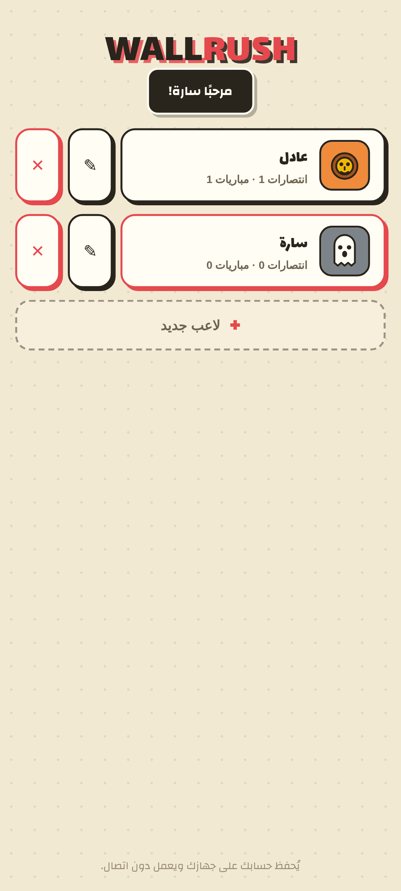

# 🧱 WALLRUSH — سباق الجدران

**والرَش** — لعبة لوحية استراتيجية كاملة للموبايل، مستوحاة من فكرة ألعاب **السباق والجدران** (مثل Blocade / Quoridor): اسبق خصمك إلى الجهة المقابلة، واعترض طريقه بالجدران!

## ✨ المميزات

- 🏁 **الفكرة الأساسية**: لوح 9×9 — في كل دور تتحرك خطوة واحدة **أو** تضع جداراً. أول من يصل الجهة المقابلة يفوز.
- 🧱 **10 جدران** لكل لاعب في المبارزة الكلاسيكية — الجدران تعيق الجميع.
- 🦘 **القفز**: اقفز فوق الخصم المجاور، وإذا اعترضه جدار خلفه فاقفز قطرياً.
- 🚫 **قاعدة منع الحصار**: لا يمكن أبداً سدّ كل الطرق — يجب أن يبقى طريق للهدف (مطبّقة بالكامل).
- 🤖 **ذكاء اصطناعي** بثلاثة مستويات (سهل/متوسط/صعب) بخوارزمية Minimax مع تشذيب Alpha-Beta.
- ⚡ **وضع Blitz**: 6 جدران و10 ثوانٍ لكل دور — حركة تلقائية عند انتهاء الوقت.
- 🎯 **وضع الرباعية**: حتى 4 لاعبين (بشر/روبوتات) على نفس الشاشة، كل واحد من جهة.
- 🌍 **8 لغات**: العربية (RTL كامل) • English • Español • Français • Deutsch • Português • Italiano • Türkçe — **شاشة اللغات أول شاشة دائماً** عند كل تشغيل، لكل لغة **شعار/علم خاص** بأسلوب ورقي، مع تمييز اللغة الحالية ✓ واللغة المقترحة تلقائياً حسب لغة الجهاز.
- ⚔️ **الموت المفاجئ**: بعد 120 نقلة يفوز الأقرب إلى الهدف — لا مباريات لا نهائية أبداً (مع دعم التعادل).
- 🎨 **تصميم «نادي الألعاب الورقية»**: خلفية كريمية دافئة، ألوان مسطحة جسورة (أحمر/أزرق/ذهبي/أخضر)، حدود حبرية سميكة وظلال صلبة — بدون تدرّجات. خطوط **Lalezar** و**Changa** مدمجة داخل الملف (تعمل دون اتصال).
- 💡 **تلميحات** و**تراجع** و**دليل المسار** لمساعدة المبتدئين.
- 👤 **حساب لاعب إلزامي** قبل أول مباراة: اختر صورة رمزية من 12 شخصية (ثعلب، باندا، بومة، روبوت…) واسمًا — مع دعم عدة حسابات على نفس الجهاز، تبديل اللاعب، تعديل الحساب وحذفه، واستيراد سجل الإنجازات القديم تلقائياً.
- 📊 إحصائيات محفوظة **لكل حساب** (انتصارات، مباريات، سلسلة) — تظهر في بطاقة الحساب وفي شريط السجل.
- 🔊 مؤثرات صوتية مولّدة برمجياً (بدون ملفات خارجية).
- 📳 **اهتزاز اختياري** للتغذية الراجعة (يُوقف من القائمة).
- 📱 **ملف واحد** يعمل دون اتصال — حسابات محلية على الجهاز، لا سيرفرات.
- 🛒 **جاهزة للنشر**: مشروع **Capacitor** كامل + أيقونات ولقطات شاشة المتاجر + نصوص القوائم + سياسة الخصوصية (انظر `PUBLISH.md`).

## 🎮 طريقة اللعب

| | |
|---|---|
| 👆 **التحرك** | اضغط على خلية متوهجة بجانب قطعتك |
| 🧱 **وضع جدار** | اضغط على الفجوة بين الخلايا → تظهر معاينة → أكّد بزر ✓ (أو اضغط الجدار مرة أخرى) |
| ⟳ **تدوير الجدار** | زر التدوير قبل التأكيد |
| ⌨️ **لوحة المفاتيح** | الأسهم/WASD للحركة، Enter للتأكيد، Esc للإلغاء |

## 🚀 التشغيل

افتح `index.html` في أي متصفح — هذا كل شيء. أو فعّل **GitHub Pages** من إعدادات المستودع لتلعب عبر الرابط.

## 📲 النشر على المتاجر

المستودع مشروع **Capacitor** جاهز: `npm install` ثم `npm run add:android` (أو `add:ios`) وابنِ عبر Android Studio / Xcode. التفاصيل الكاملة في **[PUBLISH.md](PUBLISH.md)** — يشمل الأيقونات، لقطات الشاشة، نصوص القوائم بـ8 لغات، سياسة الخصوصية، وإجابات استبيانات المتاجر.

---

# 🧱 WALLRUSH (English)

A complete mobile-first strategy board game inspired by **race & block** games (Blocade / Quoridor): race to the far side before your rival walls you in!

## ✨ Features

- 🏁 **Core idea**: 9×9 board — each turn, move one step **or** place a wall. First to reach the opposite side wins.
- 🧱 **10 walls** each in classic duel — walls block everyone.
- 🦘 **Jumps**: hop over an adjacent rival; if blocked behind, jump diagonally.
- 🚫 **No-full-block rule**: a path to the goal must always remain (fully enforced).
- 🤖 **AI** with 3 difficulties (Easy/Medium/Hard) — Minimax with Alpha-Beta pruning.
- ⚡ **Blitz mode**: 6 walls, 10 seconds per turn, auto-move on timeout.
- 🎯 **Squad mode**: up to 4 players (human/bot mix) on one screen, one per edge.
- 🌍 **8 languages**: العربية (full RTL) • English • Español • Français • Deutsch • Português • Italiano • Türkçe — **the language screen is always the first screen** on every launch, each language has its **own SVG emblem** in papercraft style, with the current one marked ✓ and the device language auto-suggested.
- ⚔️ **Sudden death**: after 120 moves the closest player to the goal wins — no endless matches (draws supported).
- 💡 Hints, undo, and a path guide for beginners.
- 👤 **Mandatory player account** before the first game: pick one of 12 avatars (fox, panda, owl, robot…) and a name — multiple accounts per device, player switching, edit/delete, and automatic import of your legacy record.
- 📊 Local stats **per account** (wins, games, streak) shown on the profile card and stats strip.
- 🔊 Procedural sound effects (no external files).
- 📳 Optional haptic feedback (toggle in menu).
- 📱 **Single file**, works offline — local device accounts, no servers.
- 🛒 **Store-ready**: full **Capacitor** project + store icons, screenshots, listings in 8 languages, privacy policy (see `PUBLISH.md`).

## 📸 Screenshots

| Language picker | Player account | Home | Switch player |
|---|---|---|---|
|  |  |  |  |

Mid-game, victory, wall preview and the how-to-play screen: `screenshots/android/04-game.png`, `06-victory.png`, `07-wall-preview.png`, `08-howto.png` (iOS set: `screenshots/ios/`).

## 🚀 Run it

Open `index.html` in any browser — that's it. Or enable **GitHub Pages** in the repo settings to play from a URL (installable as a PWA, works fully offline via service worker).

## 📲 Publish to the stores

This repo is a ready **Capacitor** project: `npm install`, then `npm run add:android` (or `add:ios`) and build via Android Studio / Xcode. Full instructions in **[PUBLISH.md](PUBLISH.md)** — icons, store screenshots, listings in 8 languages, privacy policy and store questionnaire answers included.

## 🛠 Tech

Pure vanilla HTML/CSS/JS in a single file. Canvas rendering, WebAudio synth SFX, Web Vibration API + Capacitor Haptics, PWA (manifest + service worker), embedded fonts (Lalezar + Changa, 12 subsets), localStorage persistence. Game logic is DOM-free and stress-tested: 100+ automated bot-vs-bot games across all modes and difficulties.

---
*An original implementation of public race-and-block board game rules — not affiliated with Blocade or Quoridor.*
